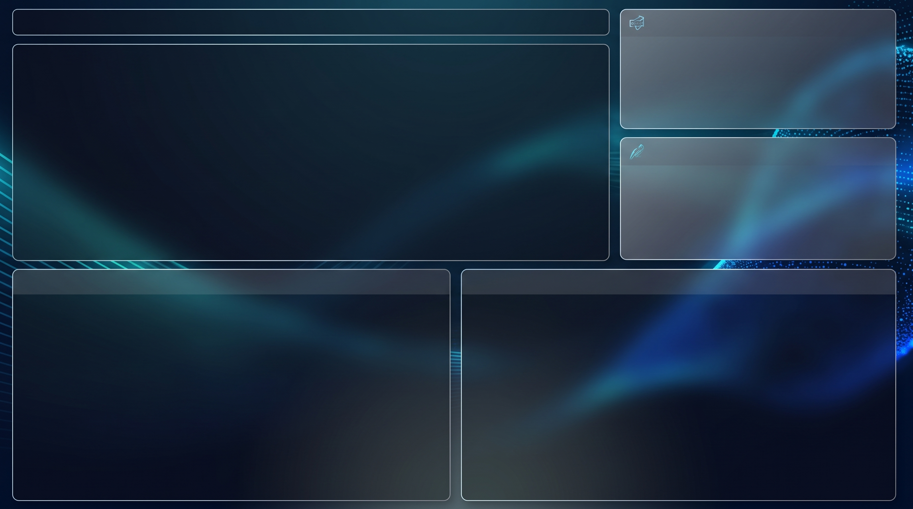

# 📊 Relatório de Vendas - Power BI

Dashboard comercial desenvolvido em **Microsoft Power BI** com foco no acompanhamento de indicadores de desempenho de vendas, faturamento por região, marcas de destaque e evolução temporal.

---

## 🖼️ Visão Geral do Dashboard

Abaixo está o layout base e estrutura visual aplicada no relatório:

---

## 🎯 Objetivos de Negócio

1. **Acompanhamento de Receita:** Monitorar o faturamento total acumulado e identificar picos de vendas ao longo dos períodos.
2. **Identificação de Top Sellers:** Visualizar de forma rápida o produto mais vendido para suporte a decisões de estoque e campanhas.
3. **Análise Geográfica:** Compreender o impacto das vendas distribuídas por continentes.
4. **Mix de Marcas:** Avaliar quais marcas geram maior volume de receita para a operação.

---

## 📈 Principais Métricas e Indicadores (KPIs)

* **Faturamento Total:** Soma total das receitas geradas no período (`SUM(Planilha1[Faturamento])`).
* **Produto Mais Vendido:** Indicador dinâmico de destaque do catálogo.
* **Quantidade Vendida:** Volume consolidado de unidades comercializadas.

---

## 🧩 Visuais e Estrutura do Relatório

| Visual | Tipo | Dimensões / Métricas Analisadas |
| :--- | :--- | :--- |
| **KPI Faturamento** | Cartão Moderno (*Card Visual*) | Faturamento Total |
| **KPI Produto Destaque** | Cartão Moderno (*Card Visual*) | Produto Mais Vendido |
| **Vendas por Continente** | Gráfico de Barras (*Bar Chart*) | `Continente` × `Faturamento` |
| **Desempenho por Marca** | Gráfico de Barras (*Bar Chart*) | `Marca` × `Faturamento` |
| **Evolução Temporal** | Gráfico Combinado (*Line & Column*) | Linha do Tempo (`Ano`/`Mês`) × `Faturamento` e `Qtd. Vendida` |

---

## 🗄️ Estrutura de Dados

* **Tabela Principal:** `Planilha1`
  * `Data da Venda` (Data)
  * `Produto` (Texto)
  * `Marca` (Texto)
  * `Continente` (Texto)
  * `Qtd. Vendida` (Número Inteiro)
  * `Faturamento` (Moeda/Decimal)

---

## 🚀 Como Executar o Projeto

1. Certifique-se de ter o **[Power BI Desktop](https://powerbi.microsoft.com/desktop/)** instalado na versão mais recente.
2. Clone o repositório ou faça o download deste diretório.
3. Abra o arquivo [`Aula 1 - Do Zero.pbix`](Aula%201%20-%20Do%20Zero.pbix).
4. Interaja com os gráficos e filtros nativos para explorar os dados.

---

## 👨‍💻 Autor

Desenvolvido por **[allissonsantosdev](https://github.com/allissonsantosdev)**.
