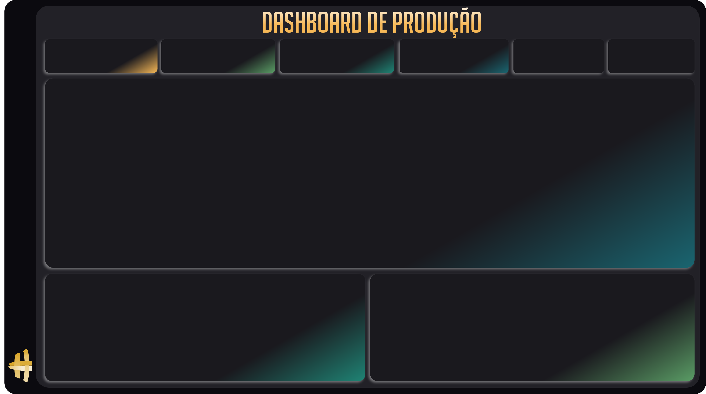

# ⚙️ Dashboard de Produção & Eficiência Operacional - Power BI

Dashboard industrial e operacional desenvolvido em **Microsoft Power BI** focado no acompanhamento de indicadores de chão de fábrica, qualidade da linha de produção, horas produtivas vs. horas paradas e performance individual de operadores. Conta com **layout responsivo para celular (Mobile Layout)**.

---

## 🖼️ Visão Geral do Dashboard

Abaixo está o layout base e os ativos visuais utilizados na construção do painel:

### Ícones de Indicadores
| Produzido / Aprovado | Rejeitado | Horas Produtivas | Horas Paradas |
| :---: | :---: | :---: | :---: |
|  |  |  |  |

---

## 🎯 Objetivos de Negócio

1. **Gestão de Qualidade:** Identificar o percentual de aprovação de peças em relação ao total rejeitado para redução de perdas/sucata.
2. **Disponibilidade e Produtividade:** Avaliar a relação entre horas paradas e horas produtivas da fábrica.
3. **Desempenho por Operador:** Permitir a filtragem e análise detalhada por operador para treinamentos e bonificações.
4. **Visão Móvel:** Facilitar a consulta dos gestores via Power BI Mobile diretamente no ambiente fabril.

---

## 📈 Principais Métricas e Indicadores (KPIs)

* **Total Aprovado:** Volume total de peças/itens aprovados pelo controle de qualidade.
* **Total Rejeitado:** Peças com não-conformidades ou defeitos identificados.
* **Horas Produtivas:** Tempo total em que a linha/máquinas estiveram em operação efetiva.
* **Horas Paradas:** Tempo ocioso ou de parada por manutenções e ajustes de máquina.
* **% Qualidade:** Taxa percentual de peças aprovadas em relação ao volume total fabricado.
* **Disponibilidade:** Indicador de prontidão operacional das máquinas e processos.

---

## 🧩 Visuais e Estrutura do Relatório

| Visual | Tipo | Finalidade |
| :--- | :--- | :--- |
| **KPI Total Aprovado** | Cartão (*Card*) com Ícone | Exibição em destaque do volume aprovado |
| **KPI Total Rejeitado** | Cartão (*Card*) com Ícone | Acompanhamento de perdas operacionais |
| **KPI Horas Produtivas** | Cartão (*Card*) com Ícone | Monitoramento de tempo ativo |
| **KPI Horas Paradas** | Cartão (*Card*) com Ícone | Monitoramento de paradas técnicas |
| **% Qualidade** | Tacômetro / Medidor (*Gauge*) | Atingimento da meta de qualidade |
| **Disponibilidade** | Tacômetro / Medidor (*Gauge*) | Nível de utilização e disponibilidade |
| **Evolução de Produção** | Gráfico de Área (*Area Chart*) | Histórico mensal de volume aprovado |
| **Filtros Interativos** | Segmentadores (*Slicers*) | Filtro dinâmico por `Operador` e `Mês` |

---

## 📱 Suporte a Layout Mobile

Este projeto inclui configuração nativa de **Mobile Layout**, permitindo visualização fluida na vertical sem cortes em smartphones via aplicativo Power BI.

---

## 🗄️ Estrutura de Dados

* **Tabela Principal:** `BaseProdução`
  * `Data Inicio` (Data/Hora)
  * `Operador` (Texto)
  * `Total Aprovado` (Número Inteiro)
  * `Total Rejeitado` (Número Inteiro)
  * `Horas Produtivas` (Decimal)
  * `Horas Paradas` (Decimal)
  * `% Qualidade` (Métrica percentual)
  * `Disponibilidade` (Métrica percentual)

---

## 🚀 Como Executar o Projeto

1. Abra o **Power BI Desktop**.
2. Abra o arquivo [`Aula 2 - Do Zero.pbix`](Aula%202%20-%20Do%20Zero.pbix).
3. Para visualizar a versão celular, vá em **Exibição** > **Layout Móvel** no menu superior.

---

## 👨‍💻 Autor

Desenvolvido por **[allissonsantosdev](https://github.com/allissonsantosdev)**.
