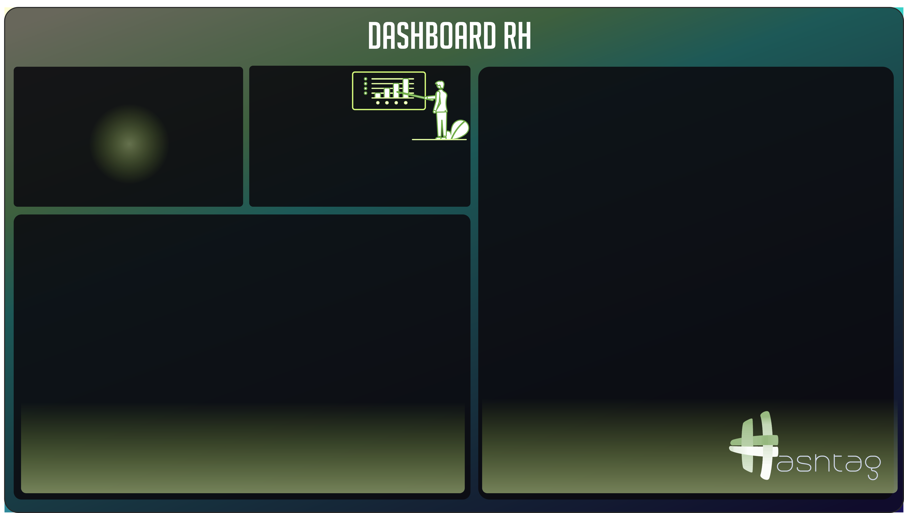

# 👥 Dashboard de Recursos Humanos (People Analytics) - Power BI

Dashboard estratégico de Recursos Humanos e **People Analytics** desenvolvido em **Microsoft Power BI** com foco em retenção de talentos, controle de turnover, folha de pagamento, horas extras e análise demográfica da equipe. Inclui página dedicada de **Dica de Ferramenta Personalizada (Tooltip)**.

---

## 🖼️ Visão Geral do Dashboard

Abaixo estão os layouts das páginas principal e de detalhamento dinâmico:

### Página Principal

### Página de Dica de Ferramenta Personalizada (Tooltip RH)

---

## 🎯 Objetivos de Negócio

1. **Gestão do Quadro de Funcionários:** Monitoramento do quadro ativo, novas admissões e volume de desligamentos.
2. **Controle de Turnover:** Identificar a taxa de rotatividade da empresa para antecipar gargalos de retenção.
3. **Análise de Custos com Pessoal:** Avaliar o impacto da folha salarial e o volume de horas extras por cargo.
4. **Análise Demográfica e Geográfica:** Entender a distribuição da equipe por gênero, cidades e áreas de atuação.
5. **Drill Down Estruturado:** Explorar a composição do quadro de colaboradores através de árvore hierárquica.

---

## 📈 Principais Métricas e Indicadores (KPIs)

* **Funcionários Ativos:** Contagem do quadro atual de colaboradores ativos na organização.
* **Contratações:** Volume de novos colaboradores admitidos no período.
* **Funcionários Desligados:** Contagem de colaboradores que saíram da empresa.
* **Turnover:** Taxa percentual de rotatividade do time.
* **Folha Salarial:** Montante financeiro total destinado aos salários (`SUM(BaseFuncionarios[Salario])`).
* **Horas Extras:** Total de horas extras acumuladas divididas por função.

---

## 🧩 Visuais e Técnicas Avançadas Utilizadas

| Visual | Tipo | Destaque Técnico |
| :--- | :--- | :--- |
| **KPIs do Quadro** | Cartões Modernos (*Cards*) | Funcionários Ativos, Contratações, Desligados e Turnover |
| **Folha Salarial** | Cartão (*Card*) | Totalizador financeiro |
| **Distribuição por Área e Cargo** | Árvore de Decomposição (*Decomposition Tree*) | Exploração analítica da raiz até o nível individual |
| **Evolução de Admissões** | Visual Customizado / Linha | Tendência anual de contratações |
| **Distribuição Geográfica & Custo** | Gráfico de Funil (*Funnel*) | Cidades com maior presença + Tooltip de salários |
| **Diversidade de Gênero** | Gráfico de Rosca (*Donut Chart*) | Proporção de funcionários ativos por gênero |
| **Horas Extras por Cargo** | Gráfico de Barras (*Bar Chart*) | Identificação de sobrecarga operacional |
| **Dica de Ferramenta (Tooltip RH)** | Página Oculta Especializada | Exibição de cards e gráficos contextuais ao passar o mouse |

---

## 🗄️ Estrutura de Dados

* **Tabela Principal:** `BaseFuncionarios`
  * `Data de Contratacao` (Data)
  * `Área` (Texto)
  * `Cargo` (Texto)
  * `Cidade` (Texto)
  * `Genero` (Texto)
  * `Salario` (Moeda/Decimal)
  * `Horas Extras` (Decimal/Inteiro)
  * `Func.Ativos` (Métrica DAX)
  * `Contratações` (Métrica DAX)
  * `Func. Desligados` (Métrica DAX)
  * `TURNOVER` (Métrica DAX)

---

## 🚀 Como Executar o Projeto

1. Abra o **Power BI Desktop**.
2. Abra o arquivo [`Aula 3 - Do Zero.pbix`](Aula%203%20-%20Do%20Zero.pbix).
3. Passe o mouse sobre os visuais para visualizar a página de **Tooltip RH** funcionando de forma dinâmica e contextual.

---

## 👨‍💻 Autor

Desenvolvido por **[allissonsantosdev](https://github.com/allissonsantosdev)**.
